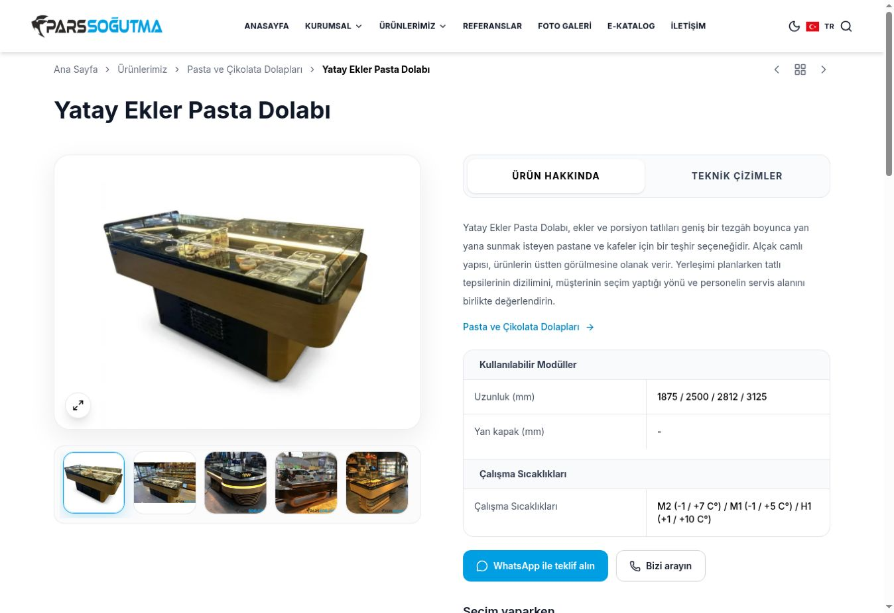

# İlk ekranın açılışı — 11 Kasım 2026

## Sorun ve değişiklik

Önceki sürüm (`1acbad495fec6dfa4d0ed86d6ae6962c53a18754`) SEO için ayrı HTML üretiyor, ziyaretçinin asıl görünümünü ise uygulama çalışana kadar yükleme ekranının arkasında tutuyordu. Görsellerin aktarımı hafiflese de bu bekleme sürüyordu.

Bu sürümde mevcut React sayfalarının **gerçek görünümü derleme sırasında hazırlanıyor**. Aynı başlık, ana fotoğraf, kartlar, açıklamalar, tablolar ve soru cevaplar ilk yanıtta yer alıyor. Tarayıcı hazır görünümü `hydrateRoot` ile etkileşimli hâle getiriyor; ilk ekran silinip yeniden oluşturulmuyor. Sunucuda her istekte render veya yeni bir hosting hizmeti gerekmiyor; Vercel statik dosyaları sunmaya devam ediyor.

- Derleme ve ilk tarayıcı render'ı aynı sayfa modülünü ve veriyi kullanıyor. Yükleme ekranı ve HTML'yi gizleyen sekiz saniyelik açılış düzeni kaldırıldı. İlk görünümün giriş animasyonları içerikleri gizlemiyor; sonraki etkileşimler korunuyor.
- Yalnızca açık ürünün tam kaydı güvenli bir `application/json` bloğunda HTML ile geliyor. İlk model için ek JSON isteği yok; sonraki modellerde önceki sürümün ayrı dosyaları ve istek önbelleği kullanılıyor. Böylece ilk HTML ile sonradan değişmiş bir model dosyası arasında fark oluşması da önleniyor.
- Floating iletişim araçları uygulama hazır olduğunda yükleniyor. Sabit içerikteki telefon/WhatsApp bağlantıları için **bağımsız ve küçük bir erken takip girişi** var. Mevcut GA4/Ads kimlikleri korunuyor; aynı GA4 örneği tekrar yapılandırılmıyor. Native ve React tıklamaları aynı olay üzerinden ayıklanarak tek dönüşüm sayılıyor. İptal edilmiş/sürüklenmiş tıklamalar ve özel mesaj/sorgu verileri gönderilmiyor.
- Kayıtlı gece modu ilk HTML ile uyumlu biçimde geri yükleniyor. Arama/filtre sorguları ilk uyumlu render'dan sonra uygulanıyor. İlk yüklemede ziyaretçi sayfayı okumaya başlamışsa konumu başa sıfırlanmıyor. Başka sayfaya geçişte üst konuma dönüş korunuyor.
- Statik 404 dosyasının farklı bir URL'de sunulduğu durumda uygulama yanlış sayfayı hydrate etmeye çalışmıyor. Bilinen sayfalarda gerçek HTML ile uyumlu açılış devam ediyor.
- Ürün fotoğraflarında `object-contain` nedeniyle görüntünün kapladığı gerçek genişlik, 4:3 çerçevenin genişliğinden küçük olabiliyor. Duyarlı görsel seçimi ve ön yükleme bu gerçek genişliğe uyarlandı; medya eşikleri, piksel yoğunluğu, çerçeve düzeni ve yakınlaştırma kaynakları korundu.
- Yazı yükü ayrıca azaltıldı. Ürün grubu sayfasının mobil ağ kaydında sekiz Inter dosyası görülüyordu. Aynı Inter 4.001 sürümünün iki değişken kalınlık dosyası kullanılarak 240.272 B yerine 133.324 B indiriliyor (%44,5 azalma; dosya içeriği, HTTP üstbilgileri hariç). `Inter` aile adı, normal stil, `swap`, Türkçe/Latin karakter kapsamı ve 400–800 kalınlık sınırları korunuyor. FontTools ile tüm karakterlerin varlığı ve aynı dikey metrikler doğrulandı; yalnızca 700 kalınlığındaki sekiz karakterde 2048 em başına bir birim yatay yuvarlama farkı bulunuyor. Yeni bir yazı tipi veya tipografi tasarımı seçilmedi.
- Sayfa adresleri, canonical ve sitemap'ler, 108 iki dilli ürün rehberi, 11 referans ve üretim teyidi bekleyen teknik değerler değiştirilmedi.

## Doğrulama

`npm run build` içinde 135 canonical sayfanın SEO kontrolleri, model/görsel performans kontrolleri, hazır ilk ekran ve etkileşime geçiş testleri, mevcut ve erken iletişim ölçümü testleri çalışıyor. `npm run lint` de uygulandı.

İlk ekran testleri 135 sayfada tamamlanmış görünüm bulunduğunu, gizli yükleme katmanı veya Suspense içerik açma betiği olmadığını doğruluyor. Üç ana örnekte **hiçbir JavaScript çalıştırılmadan** başlık ve ana görselin görünür HTML içinde olduğu kontrol ediliyor. Bunlar DOM doğruluk testleridir; hız puanı olarak sunulmuyor.

Etkileşim testleri ilk başlık DOM düğümünün korunduğunu; ürün verisinin tekrar indirilmediğini; dil, model geçişi, kayıtlı tema, arama ve okuma konumunun korunduğunu denetliyor. E-katalog, galeri ve iletişim sayfaları ayrıca kontrol edildi. Takip testleri gerçek Google'a olay veya müşterilere mesaj göndermez.

Son canlı yayında (`fdec78ffea38357564c21a4fff7262e4abfab119`) 135 canonical URL'nin tamamı HTTP 200, tek ana başlık, doğru canonical, hazır görünüm ve yeni JavaScript/CSS dosyaları açısından kontrol edildi. [Canlı HTTP kontrol kaydı](qa/first-paint-live-http-2026-11-11.json), 11 Kasım 12:31 (İstanbul). Tarayıcıda Türkçe/İngilizce geçişi, 14→15 model geçişi, ürün fotoğrafını açıp kapatma ve hata konsolu ayrıca denetlendi. Bu kontroller işlevi doğrular; laboratuvar hız ölçümünün yerini almaz.

### Uygulama sürümleri

| Değişiklik | İnceleme | Uygulama commit'i |
| --- | --- | --- |
| Gerçek görünümün statik HTML'de hazırlanması, hydration ve erken iletişim ölçümü | [PR 20](https://github.com/oguzhannsaritas/parsSogutma/pull/20) | `8f0be8d89157677d53cf184999037fece1fab574` |
| Fotoğrafın görünür genişliğine uygun dosya seçimi | [PR 21](https://github.com/oguzhannsaritas/parsSogutma/pull/21) | `43ef065a082c08ac425e3aa88aa57160f75e37ef` |
| Inter dosyalarının birleştirilmesi | [PR 22](https://github.com/oguzhannsaritas/parsSogutma/pull/22) | `2c8d65a21b8b45484fae62e8bf18c188f407f74a` |

Kaydedilmiş son canlı görünüm (PR 22 sonrası):

## Ölçüm yöntemi ve yayın öncesi sonuçlar

PageSpeed Insights **Mobil**, emülasyonlu Moto G Power, Lighthouse 13.6.0, HeadlessChromium 157.0.8103.38, yavaş 4G, ilk yükleme. Üç sayfa için üçer ayrı koşu alındı. Karşılaştırma her metrikte üç koşunun **ortanca (medyan)** değeriyle yapıldı; en iyi koşu seçilmedi.

| Sayfa | Performans koşuları | Performans medyanı | LCP koşuları (sn) | LCP medyanı | TBT medyanı | SEO |
| --- | --- | ---: | --- | ---: | ---: | ---: |
| Ana sayfa | 67 / 77 / 72 | 72 | 5,9 / 5,9 / 6,1 | 5,9 sn | 270 ms | 100 |
| Pasta ve çikolata grubu | 73 / 78 / 73 | 73 | 5,3 / 6,2 / 6,0 | 6,0 sn | 260 ms | 100 |
| Ürün 14 | 77 / 77 / 76 | 77 | 6,2 / 6,5 / 6,2 | 6,2 sn | 90 ms | 100 |

Ham ekran verileri, zamanlar, sürüm bilgileri ve Google raporu bağlantıları [ölçüm kaydında](qa/first-paint-runs-2026-11-11.json). Başlangıçtaki dokuz koşu 11:03–11:11 (İstanbul) aralığında önceki canlı sürümde alındı.

### Ara sürümler de saklandı

İlk hazır HTML yayını (`788fec9…`, `intermediate_ssr`) için sayfa başına bir teşhis koşusu alındı: ana sayfa 91 / LCP 3,2 sn; grup 91 / 3,3 sn; ürün 84 / 4,5 sn. Bu tek koşular, üçlü son karşılaştırmanın yerine kullanılmıyor.

Fotoğraf seçimi yayını (`c4e89b8…`, `intermediate_image_fit`) için üçer koşu alındı. Ana sayfa puanları 92 / 76 / 97 (medyan 92), grup 77 / 94 / 67 (medyan 77), ürün 73 / 97 / 94 (medyan 94). LCP medyanları sırasıyla 3,1 / 5,7 / 2,3 sn idi. Grup sayfasının değişken ve yüksek gecikmesi rapordan çıkarılmadı. Bu sayfanın ağ ağacında sekiz ayrı yazı dosyası tespit edilince font aktarımı ayrıca düzeltildi. Son karşılaştırma için aynı üç URL'de yeniden üçer koşu alındı; sürümler birbiriyle karıştırılmadı.

## Son yayının ölçümleri

Son uygulama yayını: `fdec78ffea38357564c21a4fff7262e4abfab119` (PR 22 birleşimi). Vercel ön izleme ve üretim yayını başarılı. Ölçümler 11 Kasım **12:29–12:33, İstanbul** saatinde alındı; başlangıçla aynı mobil profil kullanıldı.

| Sayfa | Performans koşuları | LCP koşuları (sn) | Puan medyanı | LCP medyanı |
| --- | --- | --- | ---: | ---: |
| Ana sayfa | 97 / 93 / 73 | 1,8 / 3,1 / 5,8 | 93 | 3,1 sn |
| Pasta ve çikolata grubu | 95 / 88 / 96 | 3,0 / 3,9 / 2,7 | 95 | 3,0 sn |
| Ürün 14 | 74 / 92 / 98 | 5,7 / 2,7 / 1,8 | 92 | 2,7 sn |

### Önce → sonra karşılaştırması

Her sütun kendi üç koşusunun medyanıdır; farklı koşulardaki metrikler bir araya getirilerek yeni bir puan hesaplanmadı.

| Sayfa | Puan | LCP (sn) | TBT (ms) | Speed Index (sn) | CLS | SEO |
| --- | ---: | ---: | ---: | ---: | ---: | ---: |
| Ana sayfa | 72 → 93 | 5,9 → 3,1 | 270 → 170 | 3,2 → 1,7 | 0 → 0,011 | 100 → 100 |
| Pasta ve çikolata grubu | 73 → 95 | 6,0 → 3,0 | 260 → 70 | 2,4 → 1,1 | 0 → 0,015 | 100 → 100 |
| Ürün 14 | 77 → 92 | 6,2 → 2,7 | 90 → 140 | 2,5 → 1,3 | 0 → 0,001 | 100 → 100 |

FCP medyanı üç sayfada da 0,9 sn olarak kaldı. LCP medyanındaki azalma ana sayfada yaklaşık %47, grupta %50, üründe %56. Bu, hazır ilk görünüm, fotoğraf seçimi ve font aktarımı düzenlemelerinin birlikte uygulandığı sürümün karşılaştırmasıdır; süre kazancının tamamı tek bir değişikliğe mal edilmiyor.

[Ham ölçüm kaydı](qa/first-paint-runs-2026-11-11.json) **30 benzersiz rapor** içerir: 9 başlangıç, 3 ilk hazır HTML teşhis koşusu, 9 fotoğraf seçimi ara sürümü ve 9 son sürüm koşusu. `metrics` içindeki `fcp`, `lcp`, `si` saniye; `tbt` milisaniye; `cls` birimsizdir. Her kayıtta rapor bağlantısı, yakalama zamanı, uygulama sürümü ve okunmuş ekran metni bulunur.

## Kalan sınırlar ve takip

- Son medyan puanlar 90'ın üzerinde, ancak **her koşu 90'ın üzerinde değil**. Ana sayfanın son koşusunda LCP 5,8 sn; ürünün ilk koşusunda 5,7 sn çıktı. Bu koşular korundu. Üç koşu bütün cihazlar, bağlantılar veya tüm ürünler için garanti oluşturmaz.
- LCP medyanları hâlâ 2,5 sn hedefinin üzerinde. İlk açılış gecikmesi belirgin azaldı; bütün hız işlerinin tamamlandığı veya her ziyaretin hızlı olacağı iddia edilmiyor. İlerideki teknik öncelik, kalan ana JavaScript yükünü ve ilk etkileşim maliyetini azaltmak. Ana giriş 649.832 B olarak kaldı; hazır ilk içerik bunu beklemese de etkileşimler uygulama JavaScript'ini gerektiriyor.
- Her metrik iyileşmedi: ürünün TBT medyanı 90'dan 140 ms'ye çıktı. Laboratuvar CLS medyanı önce sıfır iken son sürümde 0,001–0,015 aralığında. Hız karşılaştırması bu değerleri de içeriyor.
- PageSpeed'in üst kısmındaki son 28 günlük veriler URL'ye özel değil **kaynak/origin geneli**: LCP 2 sn, INP 140 ms, CLS 1; değerlendirme başarısız. Bu tarihsel pencere yeni laboratuvar sonuçlarından ayrıdır ve yayından hemen sonra yenilenmez. Yeni sürümün gerçek kullanıcı etkisi henüz ölçülmedi.
- SEO denetimindeki 100 puan; sıralama, başvuru veya satış artışı anlamına gelmez. Canonical adresler, sitemap'ler ve içerik kontrolleri geçti; Google sıralama etkisi bu çalışmada ölçülmedi.
- Üretimden teyit bekleyen teknik model bilgileri ayrı açık madde olarak duruyor. Bu hız çalışması, o değerlerin üretimden doğrulandığı anlamına gelmez.
