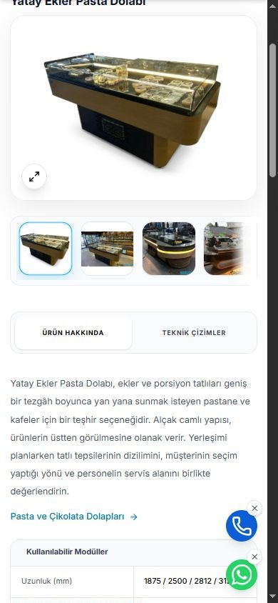

# Mobil hız çalışması — 11 Kasım 2026

## Kapsam ve başlangıç ölçümü

Ölçüm kaynağı: PageSpeed Insights web arayüzü, **Mobil**, Lighthouse 13.6.0, emülasyonlu Moto G Power, yavaş 4G, ilk yükleme. Başlangıç kaynak sürümü: `4cede25777a6ea1c2dd91fc0cafd3df0ba8a84db`.

| Sayfa | Performans / 100 | FCP | LCP | TBT | CLS | SEO / 100 | Rapor |
| --- | ---: | ---: | ---: | ---: | ---: | ---: | --- |
| Ana sayfa | 72 | 0,9 sn | 6,3 sn | 260 ms | 0 | 100 | [09:20, İstanbul](https://pagespeed.web.dev/analysis/https-parsogutma-com/z9uqge736l?form_factor=mobile) |
| Pasta ve çikolata grubu | 70 | 2,0 sn | 6,4 sn | 160 ms | 0 | 100 | [09:21, İstanbul](https://pagespeed.web.dev/analysis/https-parsogutma-com-urunler-pasta-cikolata-dolaplari/ton31z9zdq?form_factor=mobile) |
| Ürün 14 | 74 | 0,9 sn | 6,9 sn | 90 ms | 0 | 100 | [09:22, İstanbul](https://pagespeed.web.dev/analysis/https-parsogutma-com-products-14/ddhp3r5rys?form_factor=mobile) |

Ana sayfanın ikinci başlangıç koşusunda sonuç 71 puan, LCP 6,3 sn, TBT 290 ms oldu ([09:42 raporu](https://pagespeed.web.dev/analysis/https-parsogutma-com/0pgokwpx4t?form_factor=mobile)). Tek koşu puanları değişkendir; sonuçlar medyan olarak sunulmuyor.

Bu raporlardaki 28 günlük gerçek kullanıcı verisi **sayfaya özel değil, kaynak/origin geneli**: LCP 2 sn, INP 144 ms, CLS 1; değerlendirme başarısız. Yeni bir yayının laboratuvar sonuçları bu geçmiş pencerenin hemen düzeldiği anlamına gelmez.

Anonim PageSpeed API kota hatası verdi. Yerel Lighthouse tarayıcıyı başlatamadı; bu denemeler ölçüm olarak kullanılmadı. Yukarıdaki geçerli sayılar Google'ın web arayüzünden alındı.

## Uygulama

- Ortak katalog dizininden tüm modellerin uzun teknik/aksesuar tabloları çıkarıldı. Yalnızca açılan ürünün tam kaydı ve TR/EN rehberi sürümlü `/product-data/v1/{id}.json` dosyasından yükleniyor. Önceki/sonraki ürün, filtreler, fotoğraf galerisi ve istemci SEO verisi özet dizinden çalışıyor.
- 108 ürünün özgün açıklaması, seçim önerileri ve soru cevapları ilk HTML içinde korunuyor. Ürün detayındaki veri yüklenemezse yanlış modele düşmek yerine tekrar deneme gösteriliyor; paralel istekler paylaşılıyor, eski sayfadan gelen yanıtlar yeni modeli değiştiremiyor.
- 107 farklı kapak/ana sayfa görseli için oranı korunmuş WebP seçenekleri üretildi. `srcset` ve `sizes` ekranın uygun dosyayı seçmesini sağlıyor. Orijinal galeriler ve yakınlaştırma dosyaları korunuyor.
- İlk HTML'de sayfanın kendi modülü, bağımlılıkları ve ürün kaydı önceden keşfediliyor. Görsel ön yüklemeleri gösterilen görselle aynı duyarlı kaynakları kullanıyor.
- Ana sayfa slaytlarının arka plandaki görsel yüklemesi de duyarlı dosyaları düşük öncelikle kullanıyor. Otomatik geçişler ve tasarım değiştirilmedi.
- Eksik YouTube kapak dosyası, daha önce kullanılan aynı videonun resmî yedek küçük resminden üretildi. Alt bilgi logosunun hatalı 250×450 boyut bildirimi 250×45 olarak düzeltildi.
- GA4 ve Ads yükleme/zamanlama/dönüşüm davranışları değiştirilmedi.

Yerel üretim çıktısı: ana JavaScript 886,13 → 654,76 kB (gzip 204,95 → 177,77 kB); ürün detay modülü 229,93 → 25,84 kB (gzip 60,36 → 6,87 kB). Bunlar derleme boyutlarıdır, hız puanı veya gerçek kullanıcı ölçümü değildir. Örnek büyük ana sayfa fotoğrafı 323.842 bayttan 640 px seçenekte 28.356 bayta indi; hangi seçeneğin indirileceğine ekran ve piksel yoğunluğu karar verir.

## Doğrulama

- `npm run build`: 135 canonical sayfa, 9 grup, 108 iki dilli ürün rehberi, 11 referans ve karşılıklı bağlantıları; model kimlikleri, sıcaklık uyarıları, eski adresler, Google doğrulaması ve varlıklar.
- `npm run performance:check`: bütün özetlerde tam kayıtla aynı TR/EN SEO ve JSON-LD, 108 birebir tam ürün JSON dosyası, görsel kaynak boyutları/oranları, sayfaya uygun ön yüklemeler, yinelenmeyen/tekrar denenebilir veri istekleri ve yanlış model yanıtının reddi.
- `npm run analytics:check`: mevcut GA4/Ads dönüşümleri, tıklama/navigasyon davranışı, yinelenmeyen kurulum ve kişisel mesaj/sorgu verisinin gönderilmemesi.
- `npm run lint`: TypeScript denetimi.

## Canlı yayın ve yeni ölçüm

PR: [#19](https://github.com/oguzhannsaritas/parsSogutma/pull/19), uygulama commit'i `7edc12af693b1d2a67fe7429cf5ec03ed1a1ce8a`, main birleşimi `eab153994b49699db11541094c73fc4a97de74f9`. Vercel ön izleme ve üretim durumları başarılı. Canlı HTML'de `/assets/index-CTNGXW9a.js` ve yeni veri/görsel ön yüklemeleri doğrulandı.

Aynı üç URL, aynı mobil cihaz/ağ profiliyle tekrar ölçüldü. Aşağıdakiler tek koşudur; puanların tekrar koşularında değişebileceği dikkate alınmalıdır.

| Sayfa | Performans önce → sonra | LCP önce → sonra | TBT önce → sonra | Speed Index önce → sonra | Yeni CLS | SEO | Rapor |
| --- | ---: | ---: | ---: | ---: | ---: | ---: | --- |
| Ana sayfa | 72 → 76 | 6,3 → 5,7 sn | 260 → 150 ms | 3,0 → 3,8 sn | 0,008 | 100 | [10:01, İstanbul](https://pagespeed.web.dev/analysis/https-parsogutma-com/tqqtpmvmo5?form_factor=mobile) |
| Pasta ve çikolata grubu | 70 → 76 | 6,4 → 6,1 sn | 160 → 180 ms | 5,1 → 2,2 sn | 0 | 100 | [10:02, İstanbul](https://pagespeed.web.dev/analysis/https-parsogutma-com-urunler-pasta-cikolata-dolaplari/gxn1e6ekzz?form_factor=mobile) |
| Ürün 14 | 74 → 74 | 6,9 → 6,3 sn | 90 → 220 ms | 3,9 → 2,4 sn | 0 | 100 | [10:02, İstanbul](https://pagespeed.web.dev/analysis/https-parsogutma-com-products-14/78tl2n0vnc?form_factor=mobile) |

Yeni FCP her üçünde 0,9 sn; en iyi uygulamalar puanı her üçünde 100. Görsel tasarrufu uyarısı ana sayfada yaklaşık 337 → 35 KiB, grupta 277 → 8 KiB azaldı. Ürün detayında 147 → 106 KiB: kapak dışındaki galeri küçük görselleri ve logo gibi kalan kaynaklar ayrıca değerlendirilebilir.

**Değerlendirme:** Aktarım yükü azaldı, grup ve ürün sayfasının Speed Index değeri iyileşti; fakat her metrik iyileşmedi. Ana sayfa Speed Index'i ve ürün/grup TBT'si bu koşuda yükseldi. LCP 5,7–6,3 sn ile hâlâ yüksek; bu sürüm hız sorununun tümünü çözmüş sayılmıyor. Google'ın reklam/ölçüm betikleri ve istemci tarafında ilk görüntüyü oluşturma yükü kalan başlıklardır. Ölçüm/Ads işlevlerini kaldırarak puan artırılmadı. Bu sonuçlar Google sıralamasında ölçülmüş yükseliş veya saha verisinde anında düzelme değildir.

Canlı HTTP kontrolü: ana sayfa, grup ve ürün 14 200, tek H1 ve doğru canonical; 14/15/97 model JSON'ları doğru kimlik ve iki dil ile 200; 42 → 12 yönlendirmesi korundu; yerel video kapağı ve 640 px ana sayfa görseli 200. Tarayıcıda 14 → 15 → 14 geçişi, iki dilin özgün giriş/seçim/soru cevapları ve orijinal fotoğrafla yakınlaştırma doğrulandı; konsolda hata görülmedi. Gerçek arama/WhatsApp bağlantılarına tıklanmadı.

Üretimden teyit bekleyen teknik ölçü/model farkları bu performans çalışmasıyla doğrulanmış sayılmıyor; önceki içerik inceleme belgelerinde açık kalıyor.

Mobil ürün kontrolünden kesit (yakınlaştırma penceresi kapalı; gerçek tarayıcı görüntüsünün ilk görünüm bölgesi):

